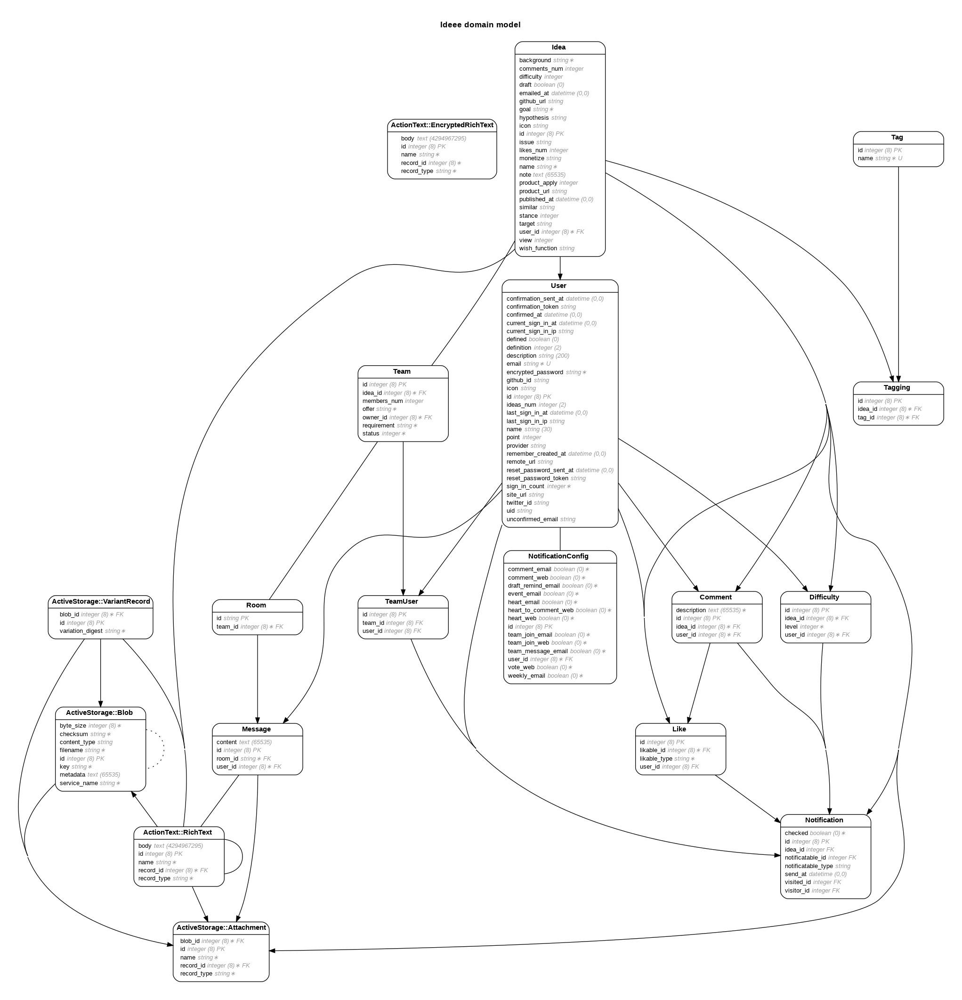

# ideee
アイデアとエンジニアのマッチングプラットフォーム

<!-- TODO Readme書く -->

## セットアップの情報

全セットアップ方法
https://www.notion.so/ideee/Engineering-Wiki-80fac88f11804c7d86ee1ac06bcfc75f

## versions

- Rails 8.1
- Ruby 3.4.12
- mysql2 (0.5.7)
- Node.js 22.x (アセットのコンパイルにのみ使用)

* System dependencies

## Heroku スタック

本番は Heroku (`ideee-tech`) の `heroku-26` スタックで動かす。

スタックを切り替えるときの手順:

1. `.github/workflows/heroku_stack_check.yml` (heroku stack check) を流し、
   新スタックのイメージ上で `bundle install` とネイティブ拡張のロードが通ることを確認する
2. `heroku stack:set heroku-26 -a ideee-tech`
3. デプロイ (スタック変更時はビルドキャッシュがクリアされ、ネイティブ拡張が全て再コンパイルされる)
4. `heroku logs -a ideee-tech` で web / worker / clock の起動と、画像アップロードを確認する

注意点:

- `.ruby-version` の Ruby は Heroku がそのスタック向けにビルドしたものだけ利用できる。
  `https://heroku-buildpack-ruby.s3.us-east-1.amazonaws.com/heroku-26/amd64/ruby-<version>.tgz`
  が 200 を返すかで確認できる
- `package.json` の `engines.node` は Heroku のサポート対象 (22.x 以降) に合わせる
- heroku-26 の ImageMagick は 7 系で、入口が `convert` から `magick` に変わる。
  mini_magick 5 系がこれを自動判別するため、ダウングレードしないこと

# ER図

`migrate時にER図を自動生成する`

# graphqlの設定

1. graphqlからSchemaダンプを作成

`rake graphql:schema:dump`

